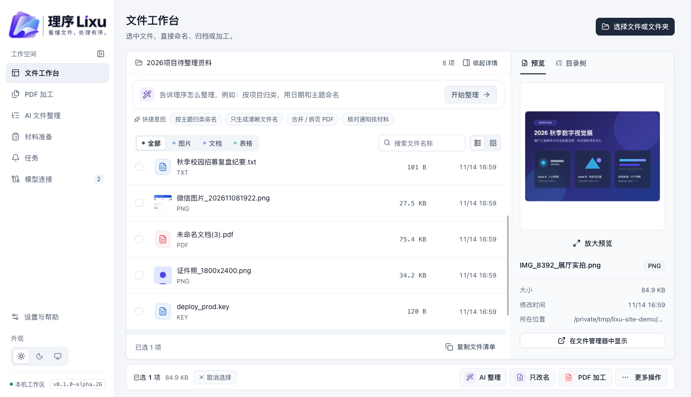
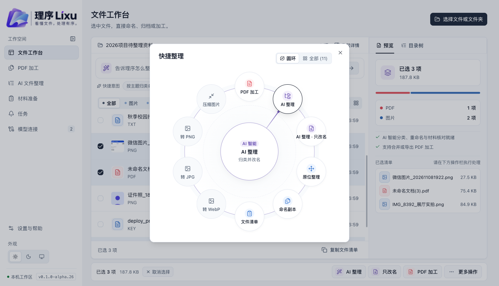
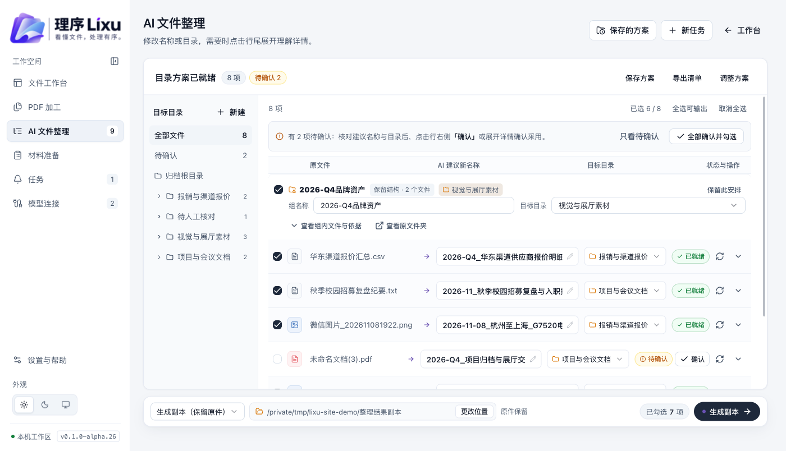
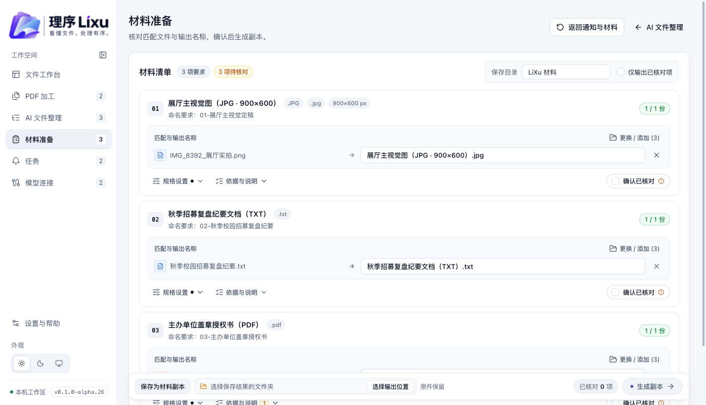
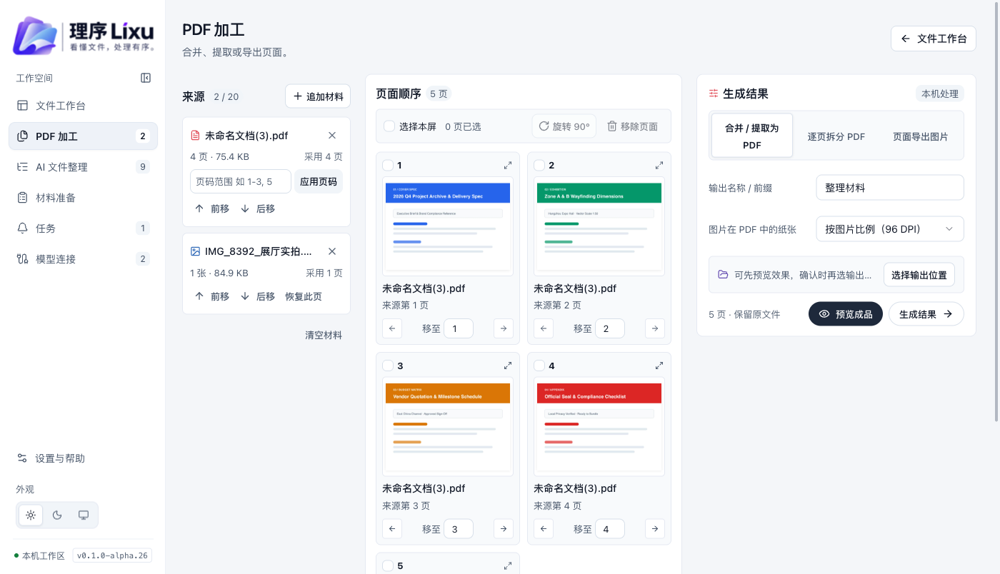
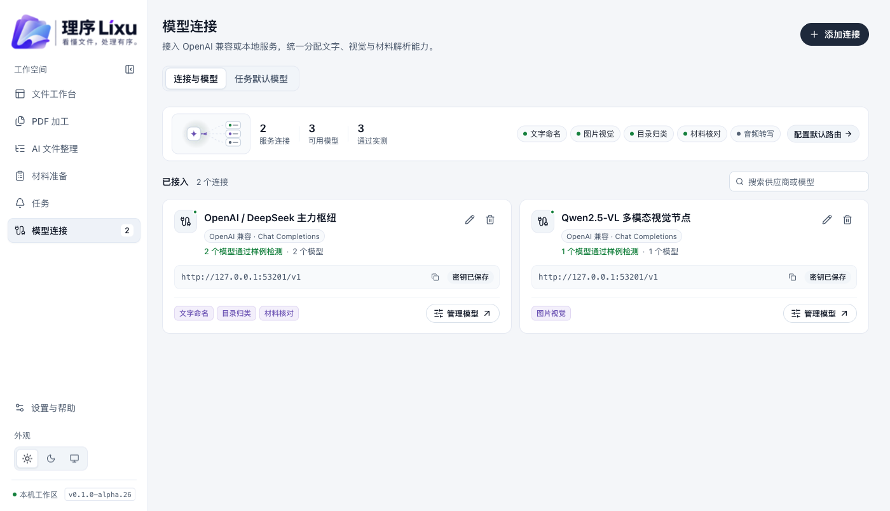
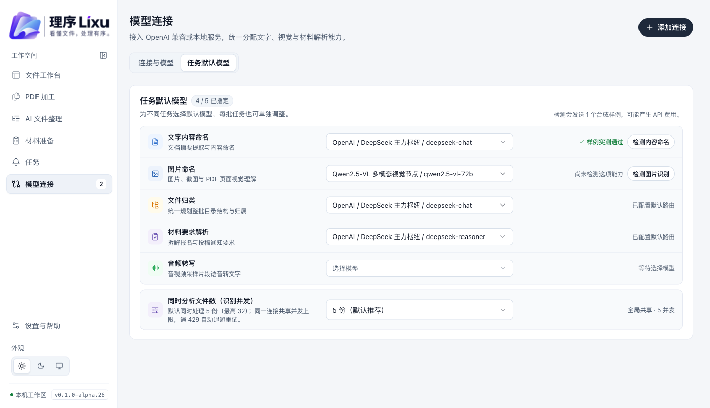
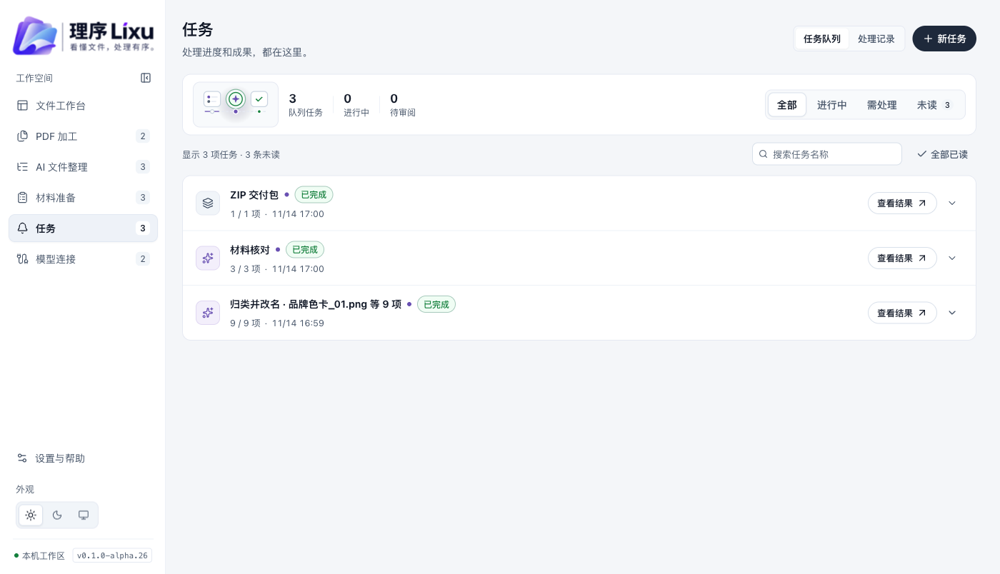
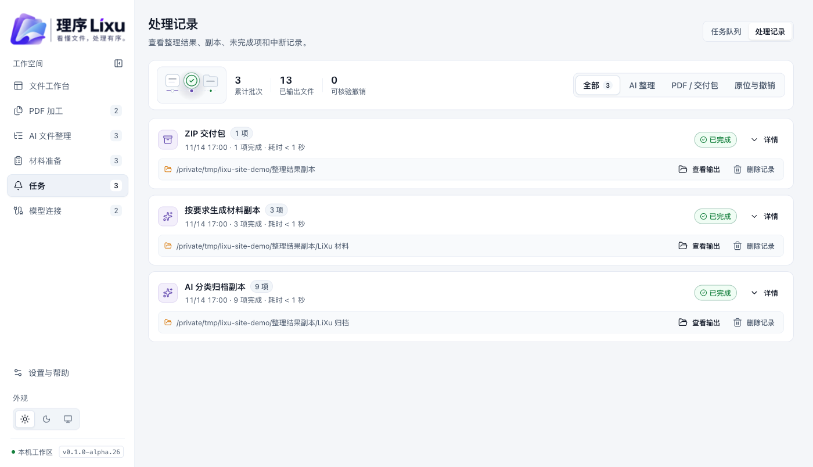

<div align="center">

  <picture>
    <source media="(prefers-color-scheme: dark)" srcset="screenshots/lixu-lockup-dark.png">
    <source media="(prefers-color-scheme: light)" srcset="screenshots/lixu-lockup-light.png">
    
  </picture>

  <p>理序是一个本地文件整理与加工工作台：整理资料、核对材料、加工 PDF 与图片，并生成可交付副本。</p>

  <p>
    <a href="https://github.com/Mr-xun/LiXu-releases/releases/latest"></a>
    <a href="https://github.com/Mr-xun/LiXu-releases/releases"></a>
    
  </p>

  <p>
    <a href="https://mr-xun.github.io/LiXu-releases/"><strong>产品官网 & 演示</strong></a> ·
    <a href="https://github.com/Mr-xun/LiXu-releases/releases"><strong>下载安装包</strong></a> ·
    <a href="https://github.com/Mr-xun/LiXu-releases/issues"><strong>问题反馈</strong></a> ·
  </p>

</div>

> 从这里下载理序正式版，查看版本更新，并提交使用反馈。理序以本地文件工作台为核心，AI 能力可接入你选择的模型服务或本机兼容服务。

## 三步上手 & 常见用法

1. **选入材料**：拖入文件或文件夹，或直接用 macOS Finder「快速操作」/ Windows「发送到」送入工作台。
2. **呼出能力**：输一句整理要求，或选中文件按 **`⌘K`**（Windows **`Shift+F10`**）打开快捷圆环，直达归类、改名、材料核对或离线改图/PDF。
3. **核对后落盘**：确认 AI 建议、依据或加工预览后再输出，**默认生成副本，保留原件**。

| 你想解决什么 | 怎么操作 | 产出结果 |
| --- | --- | --- |
| **散落文件 / 下载目录** | 工作台输一句规则或点 `AI 整理`（可选 `只改名`） | 读懂正文与图片内容，生成目录与规范文件名（原件不动） |
| **客户散包 / 通知收料** | 进 `材料准备` 贴通知或清单，再拖入混合资料 | 自动对照查缺、核对尺寸格式，一键导出 `理序材料.zip` |
| **PDF 拼接 / 批量改图** | 选中文件按 `⌘K` 或进 `PDF 加工`（**纯离线处理**） | 混排最多 20 份 PDF/图片、提取旋转拆分，或转 JPG/PNG/WebP/压缩 |
| **自有或本地大模型** | `模型连接` 填 API 凭据，`任务默认模型` 分派路由 | 文字、视觉、归类各用所长，密钥加密存于系统凭据库 |

## 功能与使用实景

> 下方实景随 GitHub 浅色 / 深色外观自动切换（基于脱敏合成示例数据截图，不含真实文件或 Key）。

### 1. 文件工作台与快捷圆环：选入即用

<table width="100%">
  <tr>
    <td width="50%" valign="top">
      <picture>
        <source media="(prefers-color-scheme: dark)" srcset="screenshots/workbench-dark.png">
        <source media="(prefers-color-scheme: light)" srcset="screenshots/workbench-light.png">
        
      </picture>
      <br>
      <strong>文件工作台 · 选入与直达</strong><br>
      <sub>按 <code>图片 / 文档 / 表格</code> 快速筛选，右侧即刻预览大图与目录树；顶部输自然语言或点快捷意图即可开跑。</sub>
    </td>
    <td width="50%" valign="top">
      <picture>
        <source media="(prefers-color-scheme: dark)" srcset="screenshots/quick-ring-dark.png">
        <source media="(prefers-color-scheme: light)" srcset="screenshots/quick-ring-light.png">
        
      </picture>
      <br>
      <strong>快捷整理圆环（<code>⌘K</code> / <code>Shift+F10</code>）</strong><br>
      <sub>围绕当前选中文件只亮起可用操作（AI 整理、只改名、原位整理、PDF 加工、转格式与压缩），右上角可切列表视图。</sub>
    </td>
  </tr>
</table>

### 2. AI 文件整理：先看懂依据，再核对落盘

<table width="100%">
  <tr>
    <td width="50%" valign="top">
      <picture>
        <source media="(prefers-color-scheme: dark)" srcset="screenshots/archive-live-dark.png">
        <source media="(prefers-color-scheme: light)" srcset="screenshots/archive-live-light.png">
        
      </picture>
      <br>
      <strong>AI 逐份理解实况</strong><br>
      <sub>后台并发读取文档正文与视觉预览，实时吐出拟议名称与「依据」；执行期间可随时点 <code>+ 新任务</code> 并行下一批。</sub>
    </td>
    <td width="50%" valign="top">
      <picture>
        <source media="(prefers-color-scheme: dark)" srcset="screenshots/archive-plan-dark.png">
        <source media="(prefers-color-scheme: light)" srcset="screenshots/archive-plan-light.png">
        
      </picture>
      <br>
      <strong>方案核对与目录保护</strong><br>
      <sub>支持只看 <code>待确认</code>、行内改名换目录、单条重解析；已有子目录默认标记 <code>保留结构</code> 不拆散，默认生成副本。</sub>
    </td>
  </tr>
</table>

### 3. 材料准备与交付打包：对照清单找齐杂乱资料

适合学校报名/报销、招聘入职以及客户经理收来一包**没有目录的平铺散件**：按要求核对缺项与格式后再交付。

<table width="100%">
  <tr>
    <td width="50%" valign="top">
      <picture>
        <source media="(prefers-color-scheme: dark)" srcset="screenshots/materials-plan-dark.png">
        <source media="(prefers-color-scheme: light)" srcset="screenshots/materials-plan-light.png">
        
      </picture>
      <br>
      <strong>贴通知即核对与改规格</strong><br>
      <sub>填入或上传要求后拆解为条目，自动匹配混杂原件并提示缺漏；可逐项设目标格式、像素尺寸与体积约束。</sub>
    </td>
    <td width="50%" valign="top">
      <picture>
        <source media="(prefers-color-scheme: dark)" srcset="screenshots/materials-result-dark.png">
        <source media="(prefers-color-scheme: light)" srcset="screenshots/materials-result-light.png">
        
      </picture>
      <br>
    <strong>副本可溯源 · 一键出 ZIP</strong><br>
      <sub>保留原件生成规范副本，确认后底部一键生成 <code>理序材料.zip</code> 交付包，或直接携相关文件跳进 <code>PDF 加工</code>。</sub>
    </td>
  </tr>
</table>

### 4. 本地 PDF 与图片加工：完全离线，不上传原件

<div align="center">
  <picture>
    <source media="(prefers-color-scheme: dark)" srcset="screenshots/pdf-dark.png">
    <source media="(prefers-color-scheme: light)" srcset="screenshots/pdf-light.png">
    
  </picture>
  <p>
    <strong>多源混排与页面加工</strong><br>
    <sub>一次混入最多 20 份 PDF 或图片：支持按页码范围提取（如 <code>1-3, 5</code>）、调整页序、旋转 90° 与移除页面，输出 <code>合并 / 提取 PDF</code>、<code>逐页拆分 PDF</code> 或按 DPI <code>导出图片</code>；图片亦支持通过快捷圆环批量转 JPG / PNG / WebP、缩放与压缩，确认「预览成品」再写副本。</sub>
  </p>
</div>

### 5. 模型连接、并发与任务溯源

<table width="100%">
  <tr>
    <td width="50%" valign="top">
      <picture>
        <source media="(prefers-color-scheme: dark)" srcset="screenshots/models-dark.png">
        <source media="(prefers-color-scheme: light)" srcset="screenshots/models-light.png">
        
      </picture>
      <br>
      <strong>接入云端或本机模型</strong><br>
      <sub>支持 OpenAI Compatible（含 Ollama 等本机服务）与 Anthropic Messages，多节点并存，密钥加密存于系统凭据库。</sub>
    </td>
    <td width="50%" valign="top">
      <picture>
        <source media="(prefers-color-scheme: dark)" srcset="screenshots/models-defaults-dark.png">
        <source media="(prefers-color-scheme: light)" srcset="screenshots/models-defaults-light.png">
        
      </picture>
      <br>
      <strong>按任务分派 & 并发控速</strong><br>
      <sub>文字命名、图片视觉、目录归类、材料解析各选默认模型，支持单发样例实测；并发 <code>1–32</code> 档可调，遇 <code>429</code> 自动退避。</sub>
    </td>
  </tr>
  <tr>
    <td width="50%" valign="top">
      <picture>
        <source media="(prefers-color-scheme: dark)" srcset="screenshots/tasks-dark.png">
        <source media="(prefers-color-scheme: light)" srcset="screenshots/tasks-light.png">
        
      </picture>
      <br>
      <strong>后台任务队列</strong><br>
      <sub>统一汇聚整理、核对与打包进度，支持按 <code>进行中 / 需处理 / 未读</code> 筛选，点「查看结果」直达成果页。</sub>
    </td>
    <td width="50%" valign="top">
      <picture>
        <source media="(prefers-color-scheme: dark)" srcset="screenshots/history-dark.png">
        <source media="(prefers-color-scheme: light)" srcset="screenshots/history-light.png">
        
      </picture>
      <br>
      <strong>处理记录与可核验撤销</strong><br>
      <sub>记录每批输出目录、文件映射与耗时，一键直达文件夹；明确范围内的同卷原位操作支持核验撤销。</sub>
    </td>
  </tr>
</table>

## 下载与安装

前往 [GitHub Releases](https://github.com/Mr-xun/LiXu-releases/releases) 下载正式版安装包（当前版本：`v0.1.1`）：

| 平台 | 适用设备 | 安装包格式 |
| --- | --- | --- |
| **macOS Apple Silicon** | M1 / M2 / M3 / M4 | `LiXu-<版本号>-mac-arm64.dmg` / `.zip` |
| **macOS Intel** | Intel 处理器 Mac | `LiXu-<版本号>-mac-x64.dmg` / `.zip` |
| **Windows 64 位** | Windows 10 / 11 x64 | `LiXu-<版本号>-win-x64.exe` |

- 下载文件名使用 `LiXu-` 前缀，安装后应用显示为「理序」。普通用户只需选择 `.dmg` 或 `.exe`；`latest*.yml`、`.blockmap` 用于应用更新，不需要单独下载。
- **版本**：本仓库只发布正式版安装包和正式版更新记录。安装或更新前请先等待应用内任务完成。
- **首次打开**：**macOS** 提示未验证开发者时，右键应用选「打开」或在「系统设置 → 隐私与安全性」允许；**Windows** SmartScreen 提示点「更多信息 → 仍要运行」。

<details>
<summary>macOS 若提示“理序.app 已损坏，无法打开”或设置中无允许按钮</summary>

1. 确认安装包来自本仓库官方 Release，并将 `理序.app` 拖入「应用程序」文件夹。
2. 打开「终端」，执行下面两条命令移除该应用的下载隔离属性：

```bash
xattr -dr com.apple.quarantine "/Applications/理序.app"
open "/Applications/理序.app"
```

若应用放在其他目录请替换路径；仅提示权限不足时再在命令前加 `sudo`。

</details>

<details>
<summary>可选：使用 SHA256SUMS.txt 校验安装包完整性</summary>

每个 Release 均附带 `SHA256SUMS.txt`：

```bash
# macOS / Linux
shasum -a 256 -c SHA256SUMS.txt --ignore-missing
```

```powershell
# Windows PowerShell
Get-FileHash .\LiXu-<版本号>-win-x64.exe -Algorithm SHA256
```

</details>

## 隐私边界与反馈交流

- **本机优先，可控发送**：文件浏览、PDF / 图片加工与处理记录全部本机离线完成；仅主动发起 AI 整理或材料核对时，才将必要正文或低尺寸预览发往你指定的模型；目录「保留结构」时不发送文件内容；API Key 不进导出清单、源码或日志。
- **问题反馈**：请前往 [GitHub Issues](https://github.com/Mr-xun/LiXu-releases/issues) 提交，附上**系统架构**（如 macOS 15 arm64 / Windows 11 x64）、**版本号**（如 `v0.1.1`）、**复现步骤**与**脱敏错误提示**，勿上传 Key、Authorization 头或敏感原件。
- **产品介绍与演示**：更多场景介绍见 [理序 LiXu 官网](https://mr-xun.github.io/LiXu-releases/)。

> **许可说明**：理序 LiXu 以专有软件形式分发，公开安装包与发布说明不表示公开应用源码或授予开源许可；安装包内第三方组件仍按各自许可证随包提供。
