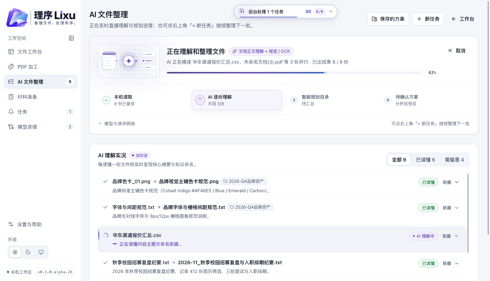
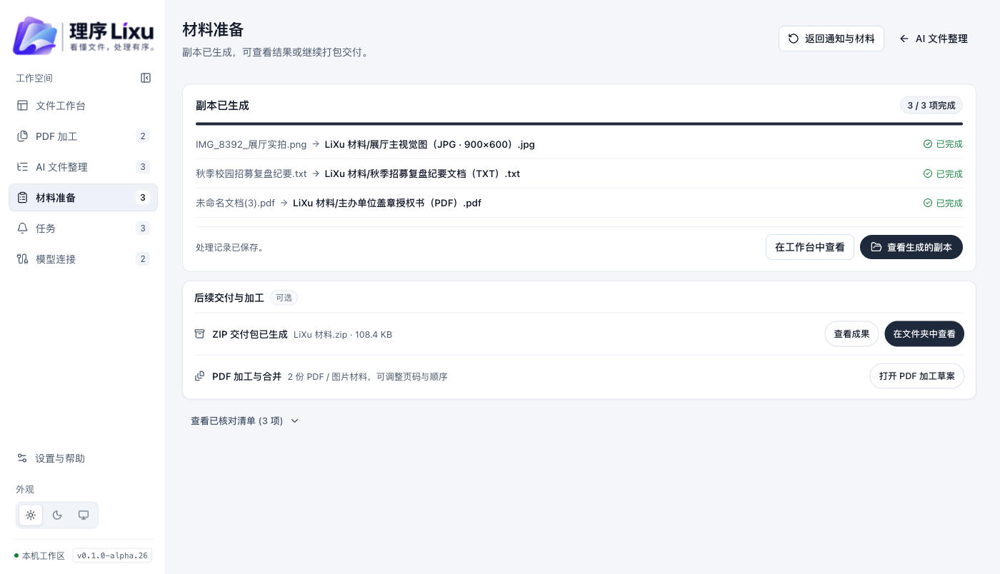

# 理序 LiXu

**看懂文件，处理有序。**

理序 LiXu 是一款本地优先的桌面文件工作台，用来整理混乱文件、核对材料、加工 PDF 和图片，并把结果保存成可继续使用或交付的副本。

[](https://github.com/Mr-xun/LiXu-releases/releases/latest)
[](https://github.com/Mr-xun/LiXu-releases/releases)

应用源码保存在独立私有仓库。这个公开仓库只用于发布安装包、版本说明和收集问题反馈，不提供源码或开放环境安装入口。

- [产品官网与界面预览](https://mr-xun.github.io/LiXu-releases/)
- [下载安装包](https://github.com/Mr-xun/LiXu-releases/releases)
- [问题反馈与建议](https://github.com/Mr-xun/LiXu-releases/issues)

## 主要功能

### 文件工作台

- 预览图片、PDF、Office 文档和文本
- 多选文件、搜索、目录浏览和快捷操作
- macOS Finder「快速操作」与 Windows「发送到」入口
- 任务、执行记录和来源核对

### AI 文件整理

- 读取正文和视觉预览，生成建议名称与目标目录
- 支持行内修改、待确认筛选、单条重解析和批量处理
- 识别并发支持 `1–32` 档调节，并对 `429` 限流自动退避
- 默认生成整理副本，保留原件；原位改名或移动需要明确确认

### 材料准备与交付

适合学校报名、入学、报销、公司招聘与入职、项目归档，以及客户经理收集客户材料等场景：

- 学校或公司一次收来一批混杂资料：证件、合同、照片、表格、扫描件和压缩包放在一起，先按通知要求整理出材料清单和缺项。
- 客户只给一个压缩包，里面是没有目录的平铺文件；按内容和材料要求生成分类目录，把文件整理成可交接的副本。
- 不必逐个打开、改名、拖进目录再反复核对；先查看建议归属、格式、尺寸、体积和来源，再确认输出。
- 生成统一材料副本或带来源清单的 ZIP 交付包，方便交给同事、学校、公司或客户继续使用。

原件默认保留在原位置，整理结果记录来源和处理状态；模型无法确定的材料会留在待确认列表，不会静默归错。

### PDF 与图片加工

PDF 和图片加工是整理、材料核对和交付流程中的本地处理环节，用来把已经选中的材料加工成可提交、可交接的副本：

- 在同一批材料里合并 PDF、提取页码、拆分页面、调整页序、旋转页面，或把图片混入 PDF。
- 根据材料要求预检页数、尺寸、体积、来源和文件冲突，确认后再生成结果。
- 图片支持 JPG / PNG / WebP 转换、缩放和压缩，用来满足提交规格、统一交付格式和控制文件体积。
- 每个结果保留来源页码或源文件记录，默认无覆盖写入；原件不会被加工过程静默替换。

它服务于“收集材料 → 核对 → 加工 → 交付”的完整流程，定位是可靠地产出副本，不替代专业排版、修图或通用 PDF 编辑软件。

### 模型连接

- 支持 OpenAI Chat Completions / Responses 与 Anthropic Messages
- 按任务绑定模型和视觉能力
- API Key 保存在当前设备的系统加密凭据存储中

## 功能截图


*文件工作台：选择文件、预览内容并进入整理流程。*



*AI 文件整理：查看建议目录和文件名，逐项确认后生成副本。*



*材料准备：核对材料状态并生成可追溯的交付结果。*

截图来自 `v0.1.0`，使用合成示例数据，不包含真实文件、账号或 API Key。

## 下载与安装

当前仅通过 [GitHub Releases](https://github.com/Mr-xun/LiXu-releases/releases) 提供桌面安装包：

| 平台 | 适用设备 | 文件格式 |
| --- | --- | --- |
| macOS Apple Silicon | M1 / M2 / M3 / M4 | `LiXu-<版本号>-mac-arm64.dmg` 或 `.zip` |
| macOS Intel | Intel 处理器 Mac | `LiXu-<版本号>-mac-x64.dmg` 或 `.zip` |
| Windows 64 位 | Windows 10 / 11 x64 | `LiXu-<版本号>-win-x64.exe` |

### 版本通道

- **稳定版**：没有 `Pre-release` 标记，适合日常使用；当前稳定版为 `v0.1.0`。
- **预览版**：版本号带有 `alpha`、`beta` 或 `rc`，GitHub 会标记为 `Pre-release`，用于提前体验和反馈。

### 首次打开

当前安装包尚未接入商业签名与公证：

- **macOS**：如提示无法验证开发者或应用已损坏，请右键点击应用选择「打开」，或在「系统设置 → 隐私与安全性」中允许打开。
- **Windows**：如出现 SmartScreen 提示，请先核对 SHA-256，再点击「更多信息 → 仍要运行」。

安装或更新前，请先等待应用内正在运行的文件任务完成。

#### macOS 显示“LiXu.app 已损坏，无法打开”

如果“隐私与安全性”里没有“仍要打开”，请按下面步骤处理。这类提示不一定会在设置页面留下按钮：

1. 从本仓库的 Release 页面重新下载，并先完成 SHA-256 校验。
2. 将 `LiXu.app` 拖到“应用程序”文件夹。
3. 打开“终端”，执行：

   ```bash
   xattr -dr com.apple.quarantine "/Applications/LiXu.app"
   open "/Applications/LiXu.app"
   ```

如果应用放在其他目录，把命令中的路径替换成实际位置。只有在提示权限不足时，才在命令前加 `sudo`。这个命令只移除该应用的下载隔离属性，不会关闭 macOS 的整体安全检查。

### 校验安装包

每个 Release 均附带 `SHA256SUMS.txt`：

```bash
shasum -a 256 -c SHA256SUMS.txt --ignore-missing
```

Windows PowerShell：

```powershell
Get-FileHash .\LiXu-<版本号>-win-x64.exe -Algorithm SHA256
```

## 隐私与安全边界

- 文件浏览、PDF / 图片加工和执行记录默认在本地完成。
- 只有在你明确启动 AI 整理或材料核对后，必要的文字或低尺寸图片预览才会发送到你选择的模型服务。
- 文件夹「仅保留结构」时，不会向模型发送文件内容。
- 整理和加工默认生成副本，原件保持不变。
- API Key 不写入导出清单、源码或错误日志。

## 问题反馈

请通过 [GitHub Issues](https://github.com/Mr-xun/LiXu-releases/issues) 反馈问题，并附上：

1. 操作系统及架构，例如 macOS 15 arm64 或 Windows 11 x64
2. 应用版本号，例如 `v0.1.0`
3. 可复现的操作步骤和实际结果
4. 经过脱敏的错误提示

请不要上传 API Key、Authorization 头、私人证件或敏感原文件。

## 许可与第三方组件

理序 LiXu 以专有软件形式分发。公开安装包和发布说明不表示公开应用源码或授予开源许可。安装包中的第三方组件仍按各自许可证提供，相关声明随安装包分发。
